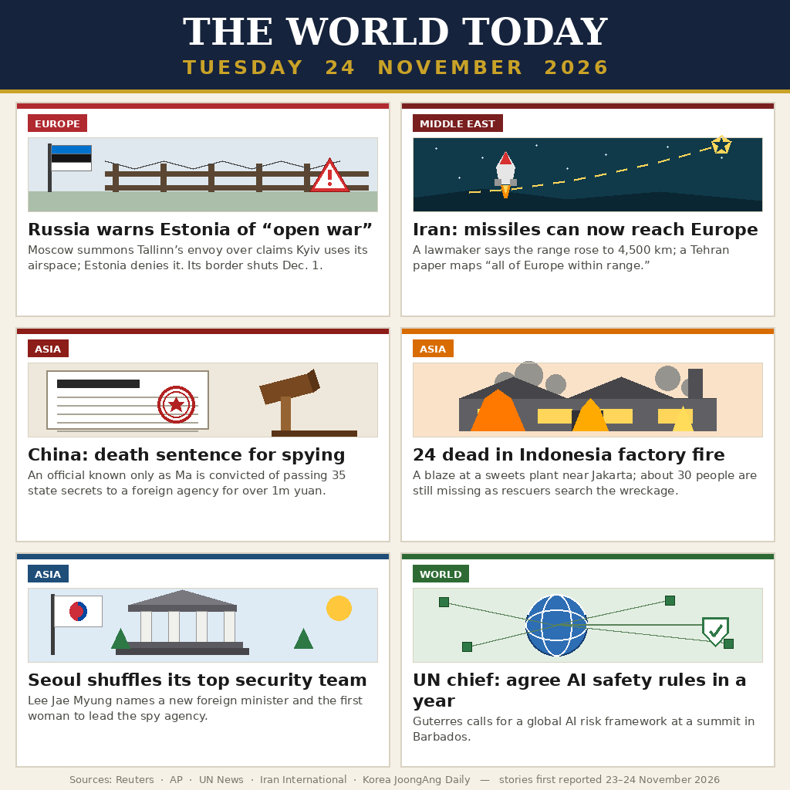

[](https://make.fun/bounty/news-image-20261124?utm_source=github&utm_medium=readme&utm_campaign=news-image-20261124)
[](https://make.fun/bounty/news-image-20261124/leaderboard?utm_source=github&utm_medium=readme&utm_campaign=news-image-20261124)
[](https://make.fun/bounty/news-image-20261124?utm_source=github&utm_medium=readme&utm_campaign=news-image-20261124)

# The World Today — Tuesday 24 November 2026

One image that sums up the world's news of Tuesday 24 November 2026:
six stories, each with an original line drawing, from Europe, the Middle
East, Asia and the world.



## What's in the picture

- **Russia warns Estonia of "open war"** — Moscow summons Tallinn's envoy
  and accuses Estonia of letting Kyiv use its airspace; Estonia denies it,
  and the border shuts on 1 December.
- **Iran: missiles can now reach Europe** — a lawmaker says the range rose
  to 4,500 km, and a Tehran paper maps "all of Europe within range."
- **China: death sentence for spying** — an official known only as Ma is
  convicted of passing 35 state secrets to a foreign agency for over
  1 million yuan.
- **24 dead in Indonesia factory fire** — a blaze at a sweets plant near
  Jakarta; about 30 people are still missing as rescuers search the
  wreckage.
- **Seoul shuffles its top security team** — Lee Jae Myung names a new
  foreign minister and the first woman to lead the spy agency.
- **UN chief: agree AI safety rules in a year** — Guterres calls for a
  global AI risk framework at a summit in Barbados.

Sources: Reuters, AP, UN News, Iran International, Korea JoongAng Daily.
Stories first reported 23–24 November 2026.

## How it is made

`draw.py` draws the poster from scratch with Pillow (all illustrations
are original line art drawn with basic shapes — no external images).
`main.py` copies the finished `entry.png` to `MAKEFUN_OUTPUT_DIR`
(`/output` by default). Run it twice and the output bytes are identical:
no network access, no clock reads.

```sh
python3 draw.py
MAKEFUN_OUTPUT_DIR=/output python3 main.py
```

## Competition

- Bounty: [news-image-20261124](https://make.fun/bounty/news-image-20261124)
- Prize: $100 · Deadline: 2026-11-26T00:00:00Z
